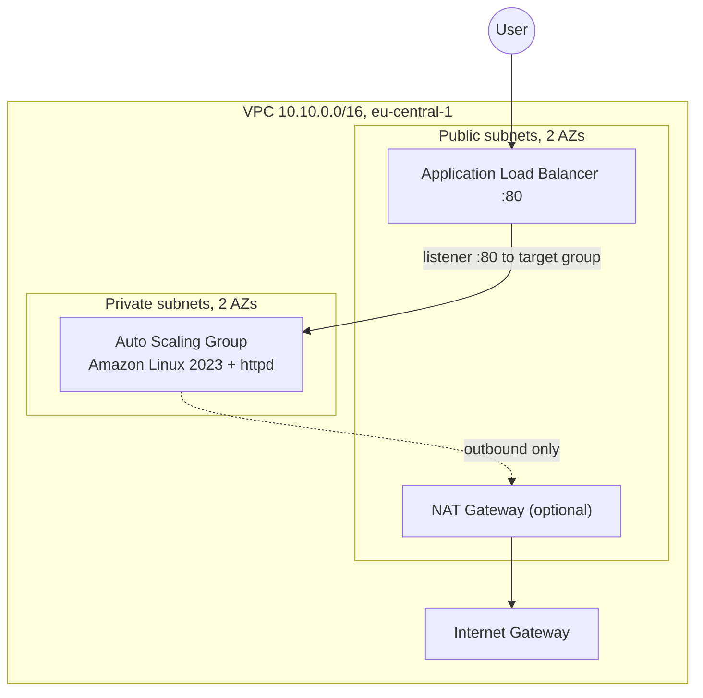

# terraform-lab01

Two-layer AWS infrastructure built with Terraform: a reusable VPC module, a network layer, and an application layer with an Application Load Balancer in front of an Auto Scaling Group.

## Architecture



- The ALB lives in the public subnets and is the only entry point.
- Instances live in the private subnets and have no public IP.
- The `web` security group accepts port 80 only from the `alb` security group, not from a CIDR range.
- Instances reach the internet for package installs through a single NAT Gateway, enabled with a flag.

## Repository layout

```
.
├── modules/
│   └── vpc/        # reusable VPC module
├── network/        # layer 1: calls the module, own state
└── app/            # layer 2: ALB, target group, launch template, ASG, own state
```

Each layer has its own remote state in S3. The `app` layer reads the network outputs through `terraform_remote_state`.

## VPC module

**Inputs**

| Name | Type | Default | Description |
|---|---|---|---|
| `name` | `string` | n/a | Name prefix and `Name` tag |
| `cidr` | `string` | n/a | VPC CIDR block |
| `public_subnets` | `map(object({ cidr = string, az = string }))` | n/a | Public subnets keyed by name |
| `private_subnets` | `map(object({ cidr = string, az = string }))` | n/a | Private subnets keyed by name |
| `create_nat` | `bool` | `false` | Create an Elastic IP, a NAT Gateway and the private default route |

**Outputs**

| Name | Description |
|---|---|
| `vpc_id` | VPC ID |
| `public_subnet_ids` | List of public subnet IDs |
| `private_subnet_ids` | List of private subnet IDs |
| `nat_gateway_id` | NAT Gateway ID, or `null` when disabled |

Subnets use `for_each` over a map, so removing one subnet does not recreate the others.

## Application layer

- Two security groups with rules as separate `aws_vpc_security_group_*_rule` resources.
- ALB, HTTP listener on port 80, target group with a health check on `/`.
- Launch template with `user_data` rendered from `user_data.sh.tftpl`. The page shows the environment, the owner, and the instance private IP and AZ read through IMDSv2.
- Auto Scaling Group across both private subnets with `health_check_type = "ELB"`.

**Outputs:** `alb_dns_name`, `web_url`.

## Usage

Requirements: Terraform 1.10 or newer, AWS provider 6.x, AWS credentials, and an existing S3 bucket for state. Set the bucket in each layer's `backend.tf`.

```bash
# 1. Network
cd network
terraform init
terraform apply          # set create_nat = true in terraform.tfvars before deploying the app

# 2. Application
cd ../app
terraform init
terraform apply
curl "$(terraform output -raw web_url)"
```

Check load balancing across both AZs:

```bash
for i in $(seq 6); do curl -s "$(terraform output -raw web_url)" | grep -E "IP|AZ"; done
```

## Teardown

Destroy in reverse order. The VPC cannot be deleted while the ALB and instances are still in it.

```bash
cd app && terraform destroy
cd ../network && terraform destroy
```

The NAT Gateway is billed per hour. Do not leave it running.
